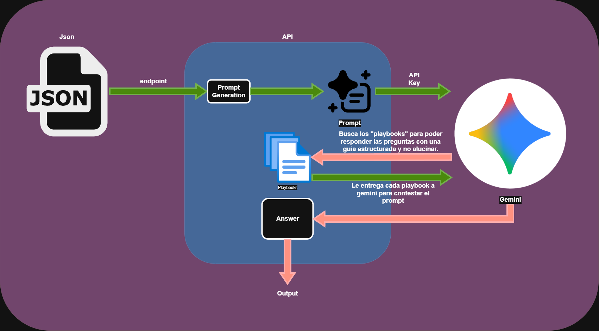

# Prueba Técnica - Andrés Madariaga

El siguiente proyecto es una prueba técnica para el puesto de software engineer junior en Lidz.ai.

## Resumen del problema

El problema a atacar se enfoca en como establecer a traves de una herramienta cuando una conversación/chat de WhatsApp vale la pena ser leída por un ejecutivo comercial y con que prioridad. Un ejecutivo requiere captar leads entre cientos de conversaciones por WhatsApp, las cuales en principio son respondidas con un asistente de IA, el problema es que sin ninguna herramienta capaz de diferenciar leads calientes de personas que se equivocaron de numero o no están realmente interesadas, los ejecutivos no tienen mas opción que hacerlo al "ojo".

## Que necesita el equipo?

Una herramienta que pueda leer una conversación y le diga al ejecutivo comercial si **vale la pena atender al chat y con que prioridad sin que este mismo deba abrir los mensajes.**

## Solución propuesta

La solución que se propone en este repositorio es una API, la cual es capaz de recibir una conversacion de WhatsApp por HTTP, la analiza con Gemini, verifica la respuesta y calcula la prioridad y responde la pregunta: **vale la pena atender al chat y con que prioridad sin que este mismo deba abrir los mensajes?**

Mas adelante se explican detalles técnicos de la implementación.

### Como se corre este proyecto?

Primero se debe clonar el repositorio en un entorno de trabajo
```
git clone https://github.com/Sarri09/Prueba-tecnica.git
```
Luego se instalan las dependencias
```
npm install
```
Seguido de esto, es importante crear un .env, siguiendo el template de .env.example

Finalmente se corre con
```
npm run dev
```

El servicio queda corriendo en localhost:3000

### Test

Para ejecutar tests se usa
```
npm test
```
Esto ejecutará una suite de 77 test, estos test no llaman a Gemini porque se simulan, dan los mismos resultados siempre.

### Evaluación
Para ejecutar la evaluación se usa el comando
```
npm run evaluar
```
Es importante saber que:

- No depende de haber corrido antes los tests
- Necesita el servidor arriba en otra terminal
- Gasta dinero
- Sobrescribe resultados/corrida-1.json
- Compara contra fixtures/esperado.json

## Proceso de desarrollo

El proceso de desarrollo fue dividido en tiempos, en primer lugar me di 40 minutos para poder analisar el problema y razonar una solución. Los primeros 20 minutos fueron de leer cuidadosamente, analisar bien que se pedía, cual debería ser la entrada y salida de lo que tenía que hacer. Luego me tomé el resto de los otros 20 minutos en pensar en una solución y escribirla, incluso en diagramarla. 

Antes de explicar mi primer approach a la solución y que cambió de esa solución después, quiero tomarme un tiempo para poder explicar como trabajé de forma documentada. 

Todas mis desiciones las fui documentando en ADRs (Architecture Decision Record) redacrtado por claude y revisadas, cuestionadas y aprobadas por mi. Este README.md es la oportunidad para poder explicar a fondo muchas de las desiciones que se tomaron.

Mi primera idea fue textual a como la escribí:

"Lo primero es que nuestra aplicacion sea capaz de captar el json a traves de un endpoint, seguido, debe sacar cada chat para analizarlo por separado, tercero la aplicacion debe generar un prompt generico, el cual le diga a gemini "Oye necesito que leas este chat y me respondas las siguientes preguntas sobre el (aqui le paso las preguntas)" hasta aqui es simplemente un prompt como cualquiera lo haría, el problema es que gemini sin contexto, sin algo que estructure como deben ser respondidas esas preguntas y que criterio debe usar, va a alucinar, va a llenar espacios en blanco con inventos y el ejecutivo va a perder totalmente la fe en la herramienta. Por ello que mi gran idea es implementar un "Playbook" para cada pregunta que debe responder gemini. Estos playbooks van a ser una guía detallada y estructurada de como gemini tiene que trabajar, definiendo un modelo de desarrollo de ideas inquebrantable, sin espacio a alucinaciones, con referencias, con desiciones, con how to, etc. Esto gemini lo lee y lo usa como guía a la hora de desarrollar su respuesta, devolviendo la mejor respuesta a nuestro servicio."

*Este texto es parte de la idea original completa, ya había explicado antes varios detalles sobre las herramientas que se tenían y que problema había que atacar.

Las preguntas que debían estar en el prompt incluía las preguntas de los ejecutivos que estan en el enunciado de la prueba.

Los "playbooks" mencionados en el texto de la primera idea serían criterion fijados por las preguntas planteadas por los ejecutivos.

A continuación un diagrama de mi idea:



### Desiciones

Esta idea no fue completamente descartada, pero si tenía muchos puntos débiles que me hizo reestructurarla, estos errores me los mostró claude code cuando solicité su opinión de mi idea:

1. Como calculo la prioridad de que un chat deba ser respondido o no?
2. La idea de hacer el prompt para que Gemini vaya a buscar los playbooks por cada pregunta y por cada chat era excecivo. El costo sería mayor y tardaría mas en dar una respuesta, todo eso se puede resolver en un solo prompt
3. El enfoque de estructurar una pregunta con una guía para que Gemini responda sin alucinaciones es válido de pensar, el problema es que para cualquier agente de IA es imposible o muy dificil eliminar por completo las alucinaciones, lo que si se puede hacer es disminuirlas. Para ello el enfoque de la solución no solo debe ser que el prompt este bien guíado, sino que la aplicacion pueda ser capaz de verificar que un dato este respaldado en la conversacion original, de lo contrario, que se anule.

La idea que salió de mi conversación con claude fue: 
1. hacer una llamada a Gemini por conversación
2. utilizar un esquema que revisa que la forma de la respuesta generada por gemini tenga forma correcta 
3. Un verificador de que el output que entrega Gemini exista en la conversación (montos, citas, etc)
4. Además se propone como calcular la prioridad con reglas fijas en código y no una decisión que toma Gemini, esta idea se desarrollará mas adelante.

De esta forma el prompt (los playbooks, resumidos en definiciones por campo) sirve para que Gemini se equivoque menos.

### La validación

Esta fue la parte mas difícil, ya que si bien se captura en las instrucciones **que necesita el equipo comercial** dentro del código, la forma de verificar que es prioritario o que suma para que algo sea prioritario y que trigger hace que una conversacion se marque como una pérdida de tiempo, en parte dependía del criterio propio. Este criterio se explica mas adelante.

## Campos utilizados
Para los campos utilizados en la respuesta, se usaron pistas que los chats entregaban, junto con lo que requerían los ejecutivos segun el enunciado de la prueba. En el siguiente punto es posible de ver en la respuesta que entrega la herramienta que campos se utilizan en el proyecto.

## Deploy
Curl de ejemplo
```
curl -X POST https://prueba-tecnica-rust-tau.vercel.app/analizar -H "content-type: application/json" -d '{"id":"demo","mensajes":[{"de":"lead","texto":"Hola, busco un depto de 2 dormitorios, tengo un pie de UF 900"}]}'
```
Respuesta de éxito:
```json
{
    "id": "demo",
    "intencion": "compra_vivienda",
    "intencion_cita": "busco un depto de 2 dormitorios",
    "urgencia": "no_indicada",
    "urgencia_cita": null,
    "capacidad_pago": [
        {
            "tipo": "pie",
            "monto": 900,
            "moneda": "UF",
            "cita": "tengo un pie de UF 900"
        }
    ],
    "tipologia": {
        "dormitorios": [
            2
        ],
        "descripcion": null,
        "cita": "busco un depto de 2 dormitorios"
    },
    "requiere_humano": false,
    "motivo_humano": null,
    "motivo_humano_cita": null,
    "alerta_manipulacion": false,
    "cita_clave": "busco un depto de 2 dormitorios, tengo un pie de UF 900",
    "prioridad": "alta",
    "resumen": "Compra vivienda · pie UF 900 · 2D · \"busco un depto de 2 dormitorios, tengo un pie de UF 900\"",
    "uso": {
        "modelo": "gemini-3.5-flash-lite",
        "tokens_entrada": 1100,
        "tokens_salida": 243,
        "tokens_thinking": 0
    }
}
```
## Criterio de prioridad

| Orden | Condición | Prioridad |
|---|---|---|
| 1 | Reclamo | `alta` |
| 2 | No es lead | `no_atender` |
| 3 | Manipulación con intención indeterminada | `no_atender` |
| 4 | Urgencia alta | `alta` |
| 5 | Compra o inversión, y dijo pie, precio máximo o presupuesto | `alta` |
| 6 | Requiere humano | `media` |
| 7 | Cualquier otro caso | `baja` |

Estas reglas son revisadas en ese orden, y la primera que se cumpla gana y define la prioridad del chat.

Un reclamo es lo mas importante porque deja clara una respuesta inmediata, no ver el chat hace que el cliente o potencial lead, aun no sabemos si es un lead o no, pero si su inquetud es acogida inmediatamente podría ser potencialmente un lead, el costo de no atenderlo al atenderlo y que no sea un lead es mucho mayor.

Gemini no es quien tiene la ultima palabra ni quien le va a informar al ejecutivo, es el código quien cupmple con ese cargo, ya que gemini por si solo puede alucinar en los espacios en blanco, la solucion que se busca es una respuesta acotada que no alucine y que permita tomar una desicion. Se prioriza el no alucinar en esta solucion por sobre todo.


## Stack tecnológico

| Desicion | Elegido | Descartado y razón |
|---|---|---|
| Framework | Hono | Descarté express porque estaba buscando un framework parecido a FastAPI pero con TypeScript y Hono era el mas parecido |
| Validación | Zod | Tenía la opción de hacer la validación a mano pero Claude me recomendó Zod |
| Deploy | Vercel | Cloud Run lo descarté porque nunca lo he usado, al contrario Vercel es el que siempre uso para mis deploys |

**Modelo Utilizado**: gemini-3.5-flash-lite

*Se descartó 3.8-flash porque es mas caro y 3.1-flash-lite porque tiene fecha de retiro.

## Estructura del código

El código es muy simple, solo hay una archivo que se conecta con Gemini para la consulta y todos los otros archivos son para preparar el terreno para la ida y vuelta de los datos.

El archivo gemini.ts es quien se conecta a gemini.

index.ts es quien pone el endpoint de /analizar para que se ejecute todo

verificar.ts Es para contrastar la conversacion original con la respuesta entregada por Gemini

prioridad.ts es para definir la prioridad de cada chat

resumen.ts es para obtener el resumen de cada chat

Se separan los archivos para poder hacer los test en cada uno por separados.

## Pruebas y resultados

Hay dos tipos de pruebas: 

1. Las 77 pruebas sin Gemini
2. La evaluación real, donde se evalúa al modelo

Los resultados están en la carpeta resultados/

Que arrojaron estos resultados:

1. El primer intento con el primer prompt que probé pasó 6/10 pruebas (las pruebas con el json de los chats)
2. Ajusté el prompt con un analisis que hizo claude sobre los test. resultando en 10/10 pruebas con éxito.
3. Probé con otros 10 chats que le pedí a otro agente inventar, sin ajustar el prompt. Pasaron solo 5/10 pruebas. Este nuevo set de pruebas las saqué de la rama.
4. Decidí no seguir ajustando el prompt, ya que siempre que probara nuevas conversaciones, iba tener que editar el prompt.

## Que costó mas

Lo que sin duda mas costó fue el proceso de razonamiento del problema, como atacarlo, que soluciones son realmente viables y cuales no. También el hecho de entender que era importante para el resultado de esta herramienta y en que priorizar el tiempo, como acotar mi proyecto y como probar que lo que si funciona funciona bien, y poder demostrar esos resultados.

Un punto en particular que me costó es definir los criterios para saber si algo es urgente o no, definir y pensar bien las prioridades. Tuve que aceptar finalmente que las correcciones de mis criterios para los distintos casos mejoraba las respuestas para los ejemplos que existían, pero no aseguraban que iba a funcionar para nuevos casos. 

Escribir también me costó mucho, tanto por tiempo como por estructurar bien las ideas, dos horas de las 4 horas me tomé en escribir con máximo detalle, aprovecho para disculparme por mis faltas ortográficas! Aunque se que no se penalizan.

## Costos
Los costos se calcularon con los tokens registrados en los casos reales que se probaron y el precio publicado por gemini. No incluye los intentos que hice anteriormente ni las pruebas que hice con las conversaciones nuevas que dejé en mi local.

| Corrida | Tokens de entrada | Tokens de salida | Costo |
|---|---|---|---|
| 1 | 11.326 | 2.122 | US$ 0,0087 |
| 2 | 11.326 | 2.173 | US$ 0,0088 |
| 3 | 11.326 | 2.118 | US$ 0,0087 |

## Que haría con mas tiempo

1. Haría una solución que pudiese resolver mas casos ante chats nuevos, quizás un modelo que pueda aprender y a buscar patrones.
2. Haría mas casos de prueba para poder ajustar mas el prompt mientras se crea una solución mas amplia.
3. Agregar una forma para que la herramienta sepa la fecha de hoy, así se relacionarían mejor las fechas con "urgencia"
4. Me gustaría documentar mejor el proceso
